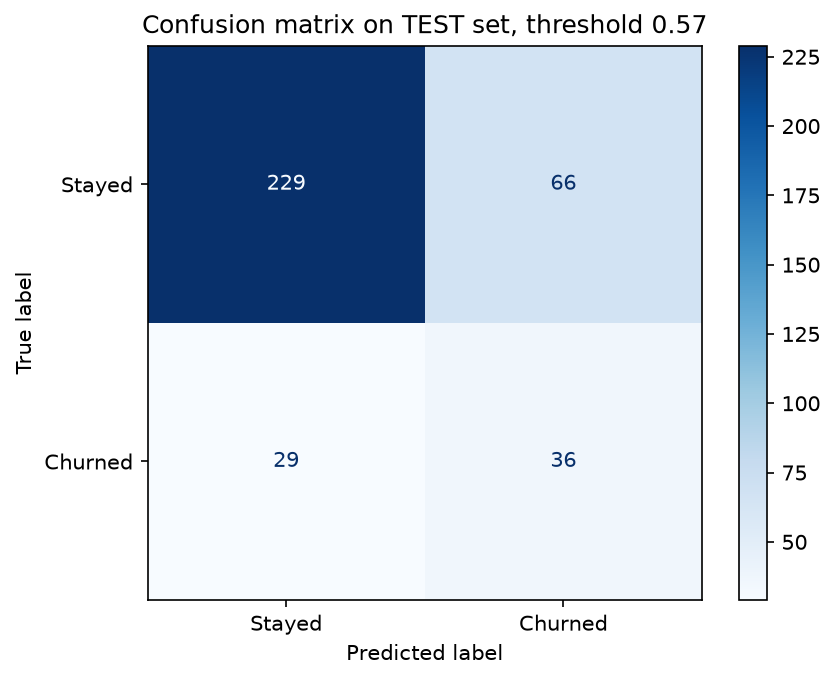

# Customer Churn Prediction

Predicting which subscription customers will leave within 30 days, so a retention team knows **whom to contact first**.

**Result:** a Logistic Regression risk ranking with **test ROC-AUC 0.76**. The riskiest 20% of customers contain **2.1× more churners than random targeting**.



---

## Key findings

**1. A higher score can be a fake score.**
One column, `retention_offer_sent`, raised ROC-AUC from 0.75 to **0.86**. Investigation showed it is *leakage*: offers are sent after the company already sees a customer leaving, and the offer is the very decision the model should support. I excluded it and kept the honest 0.75.

**2. The simplest model won.**
Logistic Regression matched or beat Random Forest, Gradient Boosting and a PyTorch neural network on the same 5 cross-validation folds. The tree models scored 0.99 on training data but 0.75 on new data (overfitting); Logistic Regression's gap was only 0.04, and its coefficients explain *why* a customer is flagged.

**3. The errors point to data, not the model.**
Missed churners look like loyal customers: 14 login days a month, versus 16 for customers who stay and 8 for the churners the model finds. No model can separate them with these columns, so the next step is new features (months until contract renewal, activity trends), not a bigger model.

## Results

| Model (5-fold CV) | ROC-AUC | PR-AUC | Train ROC-AUC |
| --- | --- | --- | --- |
| **Logistic Regression** | **0.753** | **0.429** | 0.797 |
| Random Forest | 0.747 | 0.409 | 0.992 |
| Gradient Boosting | 0.720 | 0.372 | 0.952 |
| PyTorch MLP | 0.749 | 0.422 | 0.814 |
| Business-rule baseline | 0.618 | 0.255 | – |

**Held-out test set (360 customers):** ROC-AUC 0.763 · PR-AUC 0.413 · recall 55% · precision 35% (base rate 18%) at a threshold of 0.57, chosen on out-of-fold predictions to favour recall.

## Approach

1. **Data audit:** found 18 duplicate rows, an impossible login/session combination, and two leaking columns.
2. **Leak-proof setup:** stratified 80/20 split with the test set used once; all preprocessing inside a scikit-learn `Pipeline`; the same 5 CV folds for every model.
3. **Baselines:** a majority-class model and a hand-written business rule, to prove the ML adds value.
4. **Model comparison and tuning:** grid search, a leakage experiment, and a fairness check (removing `age` cost nothing, so it was dropped).
5. **Threshold and error analysis:** threshold as a business choice, top-k lift, and the profiles of missed customers by segment.
6. **Deep Learning check:** a PyTorch MLP with early stopping, compared fairly; no gain, so the simpler model was kept.
7. **MLOps-ready output:** the saved pipeline, an input schema with version info, and an input-validation function.

## Tech stack

Python · pandas · NumPy · scikit-learn · PyTorch · matplotlib · Jupyter · Git

## Run it

```bash
python3 -m venv .venv
source .venv/bin/activate          # Windows: .venv\Scripts\activate
pip install -r requirements.txt
```
Open `notebooks/churn_analysis.ipynb` and run all cells (about 2 minutes on a laptop CPU).

## Project structure

```
data/        dataset
notebooks/   churn_analysis.ipynb – the full analysis
figures/     plots
models/      saved pipeline + metadata (threshold, input schema, versions)
report/      technical report (PDF)
slides/      presentation
```

---

*Built as the final project for the course Maskininlärning och Deep Learning at Nackademin (2026). The dataset was provided by the course. AI assistance (Claude) was used for guidance and review; all experiments and decisions are my own.*
